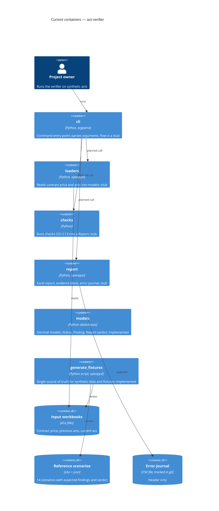

# Architecture map — act-verifier

> The **current** architecture (what exists today), produced by `survey` and read by
> specify / design / data-model / implement. Refresh with `survey` when the repo drifts past
> `reflects_commit`. This is generated; a hand-maintained `docs/architecture.md`, if present, is
> authoritative and reconciled below — not replaced.

## Stack

- Language / runtime: Python ≥ 3.11 (`pyproject.toml:9`); src layout, setuptools ≥ 68 build backend (`pyproject.toml:2-3`, `pyproject.toml:20-21`).
- Libraries: workbook reading/writing via `openpyxl>=3.1`; `pandas>=2.1` is declared but imported nowhere (`pyproject.toml:10`). Extras: `dev` = `pytest>=8` (`pyproject.toml:13`), `mcp` = `mcp>=1.0` for stage 2 — not installed in `.venv` (`pyproject.toml:14`).
- Entry point: console script `act-verifier = act_verifier.cli:main` (`pyproject.toml:17`).
- Build / test / lint:
  - install: `pip install -e ".[dev]"` (README «Швидкий старт»)
  - regenerate data + fixtures: `python scripts/generate_fixtures.py` (README «Швидкий старт»)
  - test: `.venv/Scripts/python -m pytest -q` on Windows / Git Bash (CLAUDE.md «Як перевіряти свою роботу»); pytest config `testpaths=["tests"]`, `pythonpath=["src","tests"]` (`pyproject.toml:23-25`)
  - lint / format / type-check: none configured (no ruff/flake8/mypy config, no Makefile, no CI) — `lint_cmd` stays `""`
- Test state at `reflects_commit`: 16 passed, 14 xfailed (run during this survey; matches CLAUDE.md).

## C4 — system as it is

## Module inventory

| Module | Path | Layers | Wired at | Responsibility |
|---|---|---|---|---|
| models | `src/act_verifier/models.py` | domain | imported by loaders/checks/report (`src/act_verifier/loaders.py:11`) | `Status`, `Source`, `ContractPosition`, `ActRow`, `Act`, `Finding`, `Report.verdict` — implemented |
| loaders | `src/act_verifier/loaders.py` | infra (input) | planned call from `cli.main` (`src/act_verifier/cli.py:24`) | `load_contract(path) -> dict[str, ContractPosition]`, `load_act(path) -> Act` — stubs (`:14-21`) |
| checks | `src/act_verifier/checks.py` | domain logic | planned call from `cli.main` | `verify(act, contract, previous_acts) -> Report`; constants `TOLERANCE`, `VAT_RATE` (`:13-14`) — stub (`:17-27`) |
| report | `src/act_verifier/report.py` | infra (output) | planned call from `cli.main` | `write_excel`, `render_evidence`, `append_error_log` — stubs (`:10-22`) |
| cli | `src/act_verifier/cli.py` | entry | console script (`pyproject.toml:17`) | argparse `--contract`, `--previous` (nargs `*`), `--act`, `--out` (`:18-23`), then stub (`:24-26`) |
| mcp_server | `src/act_verifier/mcp_server.py` | entry (stage 2) | — | docstring only (`:1-9`) |
| generator | `scripts/generate_fixtures.py` | tooling | run manually | writes `data/synthetic/` and `tests/fixtures/` (`main`, `:375`) |
| tests | `tests/` | tests | pytest (`pyproject.toml:23-25`) | scenario tests + fixture integrity tests |

Dependency direction: `loaders`, `checks`, `report` → `models`; `models` imports nothing internal; `cli` imports no package module yet (`src/act_verifier/cli.py:13-14`). Plain function calls, no DI or registry.

## Conventions (cited — the rules a new feature must match)

- **Module wiring / registration:** plain module-level functions composed in `cli.main`; intended order load_contract → load_act → verify → write_excel + render_evidence + append_error_log — `src/act_verifier/cli.py:24`
- **Money and quantities:** `Decimal` only, never float in arithmetic (CLAUDE.md); read Excel numbers as `Decimal(str(value))` (README «Формат вхідних файлів»); rounding `quantize(CENT, ROUND_HALF_UP)` — `scripts/generate_fixtures.py:51-52`; tolerances are `Decimal` — `src/act_verifier/checks.py:13-14`
- **Empty cells:** `None`, never 0 — `src/act_verifier/models.py:46-48`, `src/act_verifier/loaders.py:20`
- **Provenance:** every number carries a `Source(file, sheet, row)` — `src/act_verifier/models.py:17-27`; findings hold `sources` — `src/act_verifier/models.py:73`
- **Statuses / verdict:** `Status` enum pass/fail/unknown/warning — `src/act_verifier/models.py:10-14`; verdict rule in `Report.verdict` — `src/act_verifier/models.py:82-88` (same rule as `docs/checks.md:14`)
- **Check IDs:** stable strings like `C03_price_matches_contract` — `src/act_verifier/models.py:67`; the known set — `tests/test_fixtures_integrity.py:14-19`
- **Error handling:** no custom exceptions yet; only `NotImplementedError` stubs — `src/act_verifier/loaders.py:16`; argparse default exit code 2 on bad arguments — `src/act_verifier/cli.py:18-23`
- **IDs:** none beyond position codes («шифр») as dict keys — `src/act_verifier/loaders.py:15`
- **Persistence / DB access:** none — file input/output only
- **Migrations:** none (no database)
- **Tests:** pytest parametrized over fixture directories with `ids=lambda p: p.name` — `tests/test_verifier.py:16-17`; xfail with `raises=NotImplementedError` until implemented — `tests/test_verifier.py:16`; shared helpers in `tests/conftest.py:10-15`; integrity tests read xlsx directly, independent of `src/` — `tests/test_fixtures_integrity.py:1-6`
- **Fixtures:** single source of truth `scripts/generate_fixtures.py`, deterministic literal Decimals — `scripts/generate_fixtures.py:69-94`; `main()` wipes and regenerates all fixtures — `scripts/generate_fixtures.py:378`
- **Language:** identifiers English; docstrings, comments and user-facing strings Ukrainian — e.g. `src/act_verifier/checks.py:1-6`
- **Inter-module communication:** direct function calls with dataclass values — `src/act_verifier/checks.py:17-21`

## Datastores

| Store | Engine | Accessed via | Notes |
|---|---|---|---|
| Contract price | xlsx, sheet «Договірна ціна» | `loaders.load_contract` (stub) | header row 6, data from row 7 (README «Формат вхідних файлів»; `scripts/generate_fixtures.py:48`) |
| Acts | xlsx, sheets «КБ-2в» + «КБ-3» | `loaders.load_act` (stub) | КБ-2в header row 8, data from row 9, totals labels in col C, values in col G; КБ-3 labels col A, values col B, rows 5–8 (README; `scripts/generate_fixtures.py:38-47`) |
| Reference scenarios | `tests/fixtures/<scenario>/act_03.xlsx` + `expected.json` | `tests/conftest.py:10-15` | 14 scenarios (`scripts/generate_fixtures.py:256-371`); `expected.json` keys: scenario, description, inputs{contract, previous_acts, act}, expected_verdict, expected_findings[{code, check, status}] — non-pass only |
| Error journal | CSV `journal/agent_errors.csv` | `report.append_error_log` (stub) | columns date,act_file,code,check,status,expected,actual,found_by,resolution (`journal/agent_errors.csv:1`); tracked in git, not ignored |
| Reports | `reports/` | `report.write_excel` (stub) | gitignored (`.gitignore`), directory not created yet |

## Frontend / UI foundation

<!-- N/A: no frontend — command-line tool only; stage 2 adds an assistant-tool server (src/act_verifier/mcp_server.py:1-9), not a UI. -->

## Where things live / closest precedents

- A new domain model → `src/act_verifier/models.py`, modelled on `ActRow` (`src/act_verifier/models.py:40-49`): typed dataclass, `Decimal | None` for possibly-empty values, a `Source` for provenance.
- A new check → `src/act_verifier/checks.py` inside `verify`, returning a `Finding` for pass too (`src/act_verifier/checks.py:3-4`); its ID added to `docs/checks.md` and `KNOWN_CHECKS` (`tests/test_fixtures_integrity.py:14-19`).
- A new reference scenario → an `out.append((name, description, act, expected_findings))` block in `scenarios()` (`scripts/generate_fixtures.py:256`), e.g. `unit_mismatch` (`scripts/generate_fixtures.py:351-356`), built from `base_act3` / `rows_from` / `finalize` (`scripts/generate_fixtures.py:119-133`, `:248`); then rerun the generator.
- A new scenario-level test → parametrize over `scenario_dirs()` like `tests/test_verifier.py:16-31`.

## Constraints & known tech-debt

- CLAUDE.md rules are hard constraints: Decimal only; numbers only from files; missing data → `unknown`, never `pass`; fixtures changed only via the generator with a reason; the verifier never writes to inputs; every report ends with the evidence block.
- Exit-code collision: argparse exits 2 on bad arguments (`src/act_verifier/cli.py:18-23`) while 2 = needs_review (`src/act_verifier/cli.py:25`); the cli-verifier spec assigns 3 to input/invocation errors (`docs/features/cli-verifier/spec.md`).
- `test_expected_json_schema` accepts only verdicts pass/fail/needs_review and finding statuses fail/unknown/warning (`tests/test_fixtures_integrity.py:31-34`) — an expected-input-error scenario needs a schema extension.
- Integrity helper hard-codes layout: sheet «КБ-2в», `min_row=9`, column indexes, contract `min_row=7` (`tests/test_fixtures_integrity.py:40-46`, `:61-64`) — will not read shifted-layout fixtures.
- The generator regenerates every fixture at once (`scripts/generate_fixtures.py:378`), not per scenario.
- The generator writes floats into xlsx (`scripts/generate_fixtures.py:171`); arithmetic stays Decimal, readers must convert via `Decimal(str(v))`.
- The error journal is tracked in git, so any append dirties the working tree (`journal/agent_errors.csv`).
- `pandas` is declared but unused (`pyproject.toml:10`); `mcp` extra not installed.
- `Source.__str__` omits a row of 0 because of `if self.row` (`src/act_verifier/models.py:26`) — harmless for Excel rows (≥ 1).
- No lint/type-check tooling and no CI.

## Reconciliation with the authored architecture doc

No authored architecture doc (`docs/architecture.md` / `ARCHITECTURE.md`) and no ADRs exist; this map is the current reference. It is consistent with README «Структура» and «План реалізації» and with CLAUDE.md.
