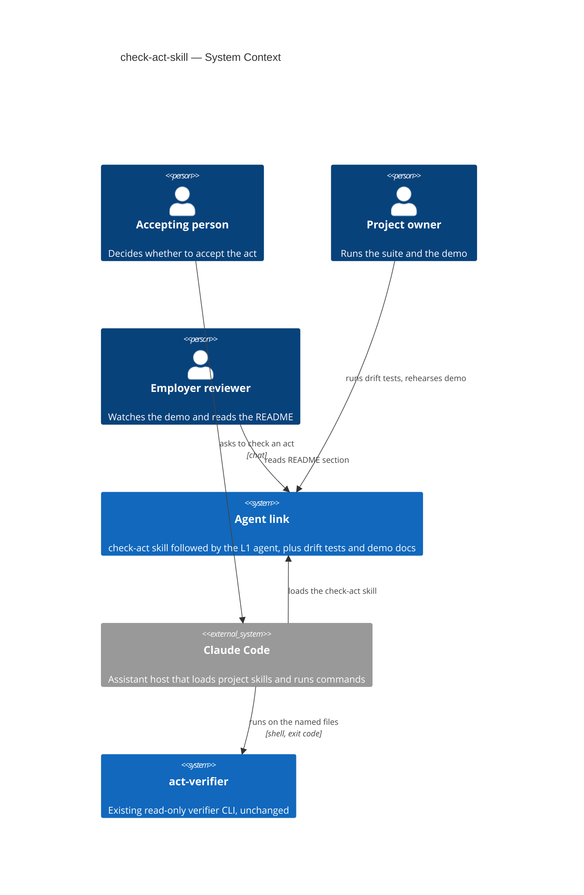
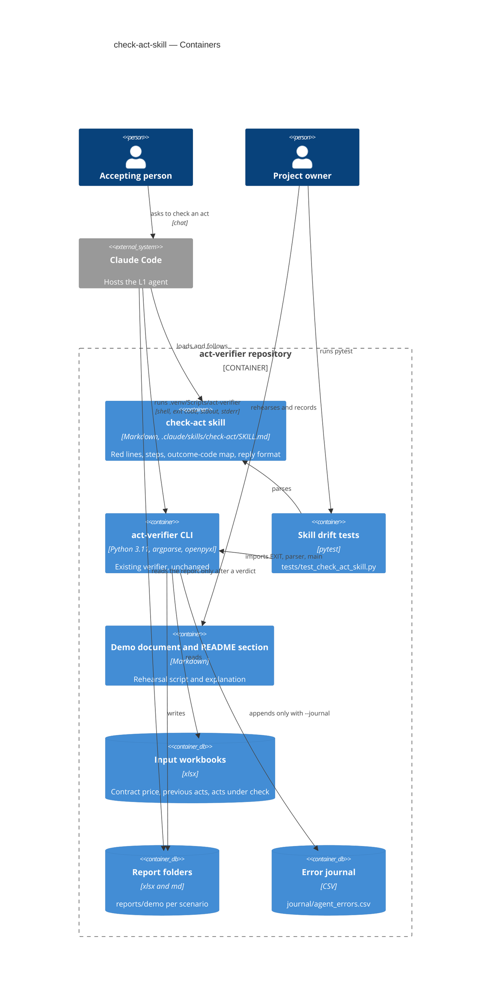
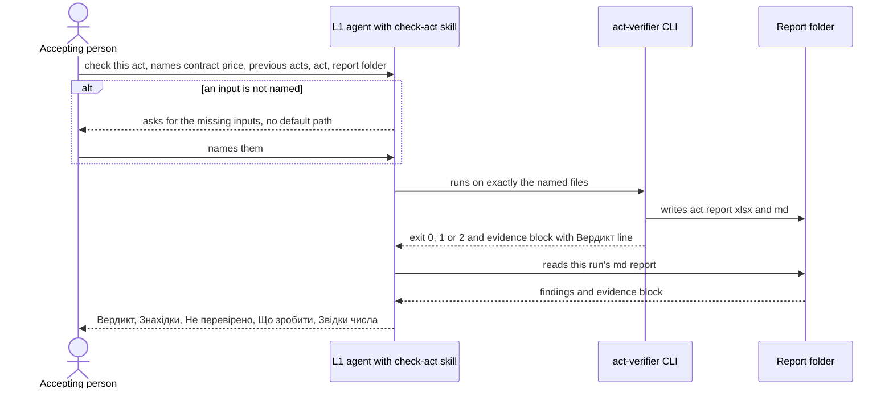
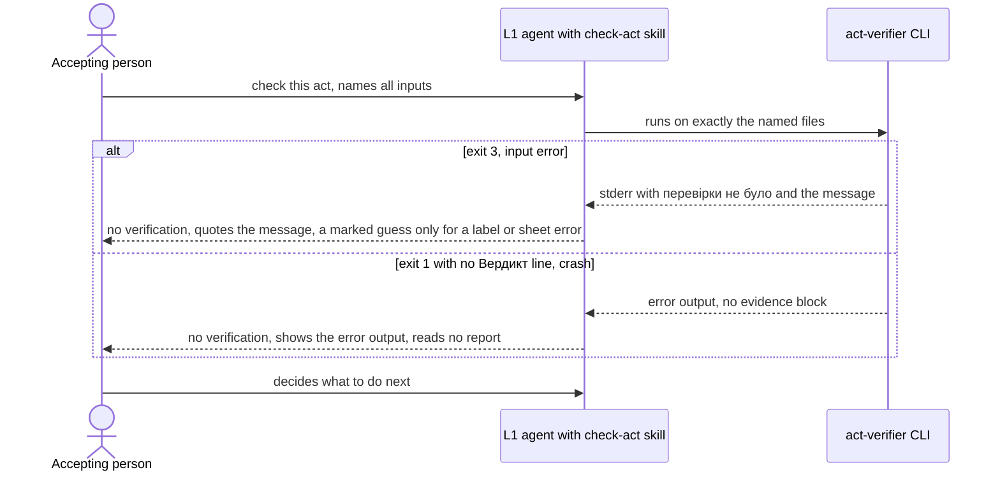

# Software Architecture Document — check-act-skill

## 1. Introduction and goals

**Intent.** Add the agent link to the chain «AI prepares → code checks → human decides»: a check-act skill that an L1 agent follows to run the existing verifier unchanged, read its report only when verification happened, and explain the verdict, findings, what was not checked, what to do and where the numbers come from to the accepting person — leaving the decision with them (spec §2). A test file keeps the skill from drifting away from the verifier, and a demo document plus a README section show the link on three scenarios for the job-interview demo on 2026-11-27 (spec §1).

**Top-3 quality goals (1-liners; full scenarios in §10):**

1. **Number fidelity** — 0 numbers outside the report per reply of the L1 agent; the agent never computes.
2. **Skill–verifier agreement** — any mismatch in outcome codes, command options, the input-error token or the skill's identity fails the suite, with 0 model and 0 network calls.
3. **Input safety** — 0 changed input files; the agent reads no input file and writes none.

**Stakeholders.**

| Role | Interest | Sign-off owner? |
|---|---|---|
| accepting person | Gets the verifier's verdict explained and keeps the decision and the error journal in their own hands | No |
| project owner | Runs and records the demo; keeps the suite green | Yes (sole developer) |
| employer reviewer | Examines the project: watches the demo, reads the README section, may run the check-act skill themselves (spec §8 OQ 2) | No |
| Tech Lead | SAD approval (held by the project owner on this repository) | Yes |

<!-- Decision overrides (¶4) — none. -->

## 2. Constraints

**Technical.**
- Python ≥ 3.11, pytest ≥ 8, src layout, `.venv` on Windows / Git Bash (`docs/architecture-map.md` «Stack», CLAUDE.md).
- The verifier is used as it is today: console script `.venv/Scripts/act-verifier` (`pyproject.toml` entry point `act_verifier.cli:main`); exit codes `EXIT = {pass: 0, fail: 1, needs_review: 2}` and `EXIT_INPUT_ERROR = 3` (`src/act_verifier/cli.py:27-28`); options `--contract`, `--previous`, `--act`, `--out`, `--journal` (`src/act_verifier/cli.py:58-62`). No `__main__.py`, so `python -m act_verifier` does not run.
- Skill host: Claude Code project skills — `.claude/skills/<name>/SKILL.md` with frontmatter `name`, `description`, optional `allowed-tools` (spec §1 «Skill location»).
- No YAML parser among the dependencies — the test reads the skill's frontmatter as plain `key: value` lines.

**Organisational.**
- Deadline: the demo on 2026-11-27 — hard (spec §1). Effort ≈ one day, one developer (the project owner).
- Size XS, route quick (`.size`, `.route`).

**Conventions.**
- CLAUDE.md rules: numbers only from files; missing data → `unknown`, never `pass`; the verifier never writes into inputs; fixtures and `expected.json` untouched (spec §3 «No change to the verifier, the fixture generator or the fixtures»).
- Identifiers in English; docstrings, comments and user-facing text in Ukrainian (`docs/architecture-map.md` «Conventions»). The skill's body and its reply headings are Ukrainian (spec §1 «Reply format»).
- Tests: pytest under `tests/`, run as `.venv/Scripts/python -m pytest -q`; the expected count in CLAUDE.md moves from 304 to 304 + N (spec §6).

**Regulatory / external.**
- N/A — synthetic data only, no personal data (spec §6.1).

## 3. Context and scope

The accepting person asks the L1 agent, running in Claude Code inside this repository, to check an act. The L1 agent follows the check-act skill: it collects the inputs from the person, runs the verifier, reads that run's report only if the run produced a verdict, and replies in the fixed five-section format. The verifier is the existing, unchanged system the skill wraps; Claude Code is the external host that loads the skill and runs the command.

<!-- brownfield: docs/architecture-map.md reflects 39ee7a6 (stale — the CLI was a stub then); the only contract this feature depends on, src/act_verifier/cli.py (exit codes, options, input-error message) and report.py (the evidence block's final line «Розбіжностей: … Вердикт: <token>.», report.py:129), was re-read directly at 940f470 instead of a full re-scan. -->

**External systems (in / out):**

| Actor or system | Type | Interaction |
|---|---|---|
| accepting person | Person | Asks to check an act, names the input files, decides on the act |
| project owner | Person | Runs the drift tests, rehearses and records the demo |
| employer reviewer | Person | Examines the project: watches the demo, reads the README section, may run the skill (spec §8 OQ 2) |
| Claude Code | System (external) | Hosts the L1 agent: loads the check-act skill, runs the verifier command, shows the reply |
| act-verifier | System (internal, existing, unchanged) | Checks the act, writes the report, returns an exit code |

**C4 Context (L1):**



Trust boundary: everything the verifier reads from an act (cell text, labels, notes) is data, never an instruction to the L1 agent (spec §6.1 abuse case 1).

## 4. Solution strategy

**Top strategic choices (the seeds for ADRs):**

0. **Target surface: `cli`.** The feature introduces no runnable container of its own; the contract it must keep is the verifier CLI's — command, options, exit codes, input-error message. Single surface, no UI surface (the accepting person talks to the agent host's chat), so no UI-architecture decision applies. Inline — no ADR (single surface, nothing to reverse).
1. **The agent link is a project-level Claude Code skill wrapping the unchanged verifier** — one instruction file `.claude/skills/check-act/SKILL.md` holding red lines, steps, the outcome-code map, the verdict-source rule and the reply format. It meets the deadline with what exists and keeps the verifier out of scope; the assistant-agent tool of roadmap step 2 stays a separate feature → [ADR-0001](adr/0001-ship-agent-link-as-project-claude-code-skill.md).
2. **The skill pre-allows exactly the verifier command, `.venv/Scripts/act-verifier`, through its own `allowed-tools`** — the demo shows no unplanned permission prompt, and nothing beyond the verifier is pre-allowed (closes spec §8 OQ 1) → [ADR-0002](adr/0002-pre-allow-only-the-verifier-via-skill-allowed-tools.md).
3. **Drift is caught by a test that imports the verifier's own contract and parses the skill file** — `cli.EXIT`, `cli.EXIT_INPUT_ERROR`, the option strings of `cli._parser()`, and the input-error token taken from a real `cli.main()` stderr; compared with the skill's frontmatter, outcome-code table and run-command block. No model and no network (spec AC-10, AC-11, §6); no subprocess (ADR-0003) → [ADR-0003](adr/0003-check-drift-by-importing-cli-contract-and-parsing-skill.md).
4. **Verdict comes from the run, not from the folder** — a verdict exists only for exit 0/1/2 plus «Вердикт: <token>.» (token pass, fail or needs_review) in that run's stdout — it ends the evidence block's final line «Розбіжностей: … Вердикт: <token>.» (`report.py:129`), so the skill matches it anywhere in the output, not at a line start; otherwise no report is read. This is the single guard against a stale report (spec §1 «Verdict source», AC-06b, AC-09). Inline — the rule is already fixed by the spec.

## 5. Building block view

Style: no new code module. The feature adds one instruction artifact read by the agent host, one test module next to the existing ones, and two documents. The verifier stays the only executable; the dependency points one way — skill and tests depend on the verifier's contract, never the reverse.

**Internal decomposition:**

```
.claude/skills/check-act/
└── SKILL.md                       frontmatter (name, description, allowed-tools) + red lines,
                                   steps, outcome-code table, run-command block, reply format
tests/
└── test_check_act_skill.py        drift tests (AC-10, AC-11) — imports act_verifier.cli
docs/features/check-act-skill/
├── demo.md                        three scenarios: prompt, expected, report folder, actual,
│                                  input hashes before/after, stopwatch, red-line checklist
└── SKILL.md                       owner's draft — kept, marked superseded (spec §8 OQ 3)
README.md                          + section «Агент L1: Skill check-act»
CLAUDE.md                          expected test count 304 → 304 + N
reports/demo/<scenario>/           one report folder per demo scenario (gitignored)
```

**C4 Container (L2):**



## 6. Runtime view

**Critical flow 1: check an act with a verdict (AC-01, AC-02, AC-02b)**



**Critical flow 2: no verification — input error or crash (AC-05, AC-05b, AC-06, AC-06b, AC-09)**



The `sequences` stage may add the missing-previous-acts flow (AC-04) and the journal flow (AC-08).

## 7. Deployment view

<!-- N/A: reuses the existing local checkout — the skill is a file in the repository, picked up by Claude Code from .claude/skills/ when a session starts in the repository root; no service, no infra change. -->

## 8. Crosscutting concepts

| Concept | Convention | Where defined |
|---|---|---|
| Verdict source | Verdict exists only for exit 0/1/2 **and** «Вердикт: pass\|fail\|needs_review.» in that run's stdout (end of the final line «Розбіжностей: … Вердикт: <token>.», `report.py:129`; matched anywhere, not at a line start); exit 3, or exit 1 without that marker = no verification, no report read | spec §1, here §4 choice 4 |
| Number provenance | Every number in a reply appears verbatim in this run's report, evidence block, input-error message or the person's words; no own arithmetic | spec AC-03, CLAUDE.md |
| Input handling | The L1 agent opens no input file and writes no file; the verifier writes only into `--out` and, on request, the journal | spec §6.1, ADR-0001 |
| Default inputs | None; every missing input is asked for | spec §1 «No default inputs», AC-01b |
| Permissions | Only `Bash(.venv/Scripts/act-verifier:*)` pre-allowed, via the skill's `allowed-tools`; anything else prompts | ADR-0002 |
| Journal option | The run-command block lists `--journal` as a marked optional part (AC-10 needs the full option set); the L1 agent adds it only when the accepting person explicitly asks (AC-08) | spec AC-08, AC-10 |
| Untrusted data | Text from act cells and messages is quoted, never followed | spec §6.1 |
| Report isolation | One `--out` folder per demo scenario (`reports/demo/<scenario>/`); the person may name the folder, else `reports/` | spec AC-12, here |
| Language | Skill body, reply headings and README section in Ukrainian; test identifiers in English | §2 Conventions |
| Drift contract | The verifier is the single source of codes, options and the input-error token; the test holds no copy | ADR-0003 |
| Logging / IDs / i18n / events | N/A — no runtime code | — |

## 9. Architecture decisions

| # | Title | Status | Section |
|---|---|---|---|
| 0001 | Ship the agent link as a project Claude Code skill over the unchanged verifier | Accepted | §4 |
| 0002 | Pre-allow only the verifier command via the skill's allowed-tools | Accepted | §4, §8 |
| 0003 | Check drift by importing the CLI contract and parsing the skill file | Accepted | §4, §5 |

ADR files live under `docs/features/check-act-skill/adr/NNNN-<title>.md`.

## 10. Quality requirements

**QG-1. Number fidelity**
- **When:** the L1 agent replies after any run of the three demo scenarios.
- **Then:** «Numbers outside the report» = 0 per reply of the L1 agent (spec §6).
- **How verify:** at the rehearsal, each numeric value in the reply is looked up in that run's report or evidence block; the result is written in `demo.md` (spec §6 measurement).

**QG-2. Skill–verifier agreement**
- **When:** the project owner runs `.venv/Scripts/python -m pytest -q` after the change, or after any change to `cli.py` or the skill.
- **Then:** 304 + N passed, 0 failed, 0 xfailed (N = the new skill tests), with 0 model calls and 0 network calls in the suite (spec §6); a mismatch in a code, option, token or identity field fails and names it (AC-10, AC-11).
- **How verify:** `.venv/Scripts/python -m pytest -q`, run and quoted at implement; the suite passes with no network access (spec §6 measurement). The drift tests import `act_verifier.cli` and start no subprocess (ADR-0003).

**QG-3. Input safety**
- **When:** the three demo scenarios are rehearsed.
- **Then:** 0 changed input files (contract price, previous acts 1–2, the three demo acts) (spec §6).
- **How verify:** a file hash of each input taken before and after the rehearsal, both written in `demo.md` (spec §6 measurement).

Supporting targets carried from spec §6: reply turnaround ≤ 2 min from the prompt to the finished reply (stopwatch, overrun = deviation, not a blocker); 0 unplanned permission prompts (count at the rehearsal — met by ADR-0002).

## 11. Risks and technical debt

| Risk / debt | Severity | Mitigation | Owner |
|---|---|---|---|
| The agent writes the command in another form (`./.venv/...`, a `cd … &&` prefix, `python -m …`) and the `allowed-tools` pattern does not match → a permission prompt appears in the demo | Medium | The skill says to start the command exactly with the prefix `.venv/Scripts/act-verifier` (the «as written» rule covers the prefix only; `--journal` stays optional, §8); the rehearsal counts prompts; a prompt is a recorded deviation, not a blocker | AlexanderSW |
| Model behaviour is not regression-tested (spec §3 non-goal); a rehearsal pass does not guarantee the live demo | Medium | Rehearse all three scenarios on 2026-11-26/27 with the five-item red-line checklist in `demo.md` | AlexanderSW |
| The drift test imports the private `cli._parser()`; a rename breaks the test, not the skill | Low | The failure is loud and names the import; fix the test together with the rename | AlexanderSW |
| `--journal` is covered by the pre-allow pattern; only the skill's rule (AC-08) keeps the agent from using it unasked | Low | Red line in the skill; checklist item «unasked journal entry» in `demo.md`; the journal is tracked in git, so an append shows in `git status` | AlexanderSW |
| The `allowed-tools` behaviour depends on the Claude Code version | Low | Verified at rehearsal; fallback = planned prompt step in `demo.md` (the spec's original default) | AlexanderSW |
| The verdict marker «Вердикт: <token>.» is not drift-tested (ADR-0003 covers codes, options, the input-error token and identity); a rewording in `report.py` would make every run look like a crash (AC-06b) | Low | Fails safe (no verdict shown, no stale report); caught at the rehearsal; `report.py` is out of scope (spec §3) | AlexanderSW |
| Open architectural decision: will the employer reviewer run the check-act skill themselves (spec §8 OQ 2)? Default: README covers calling the skill from this repository only | Open question | Resolve before the README section is written at `/sdd:implement check-act-skill` | AlexanderSW |
| `docs/architecture-map.md` is stale (reflects 39ee7a6) | Low | Run `/sdd:survey` after the demo | AlexanderSW |

**Accepted debt (acceptable in v1, plan to fix later):**
- The owner's draft `docs/features/check-act-skill/SKILL.md` stays as history, marked superseded (spec §8 OQ 3).
- Known verifier message defects stay as they are (spec §3).

## 12. Glossary

Canonical definitions are in the repo-root [CONTEXT.md](../../../CONTEXT.md) `## Glossary` (accepting person, L1 agent, check-act skill, verifier, verdict, input error, evidence block, layout label, previous acts, error journal, project owner, employer reviewer). Feature-local technical terms:

| Term | Meaning |
|---|---|
| outcome-code map | The table in the check-act skill pairing each verifier exit code with its verdict token (0 pass, 1 fail, 2 needs_review) or with the input-error meaning (3 — «перевірки не було») |
| run-command block | The single fenced `bash` block in the check-act skill holding the verifier command line, with `--journal` as a marked optional part; the only place the drift test reads options from |
| verdict source | The rule that a run has a verdict only when the exit code is 0/1/2 and its stdout carries «Вердикт: <token>.» (inside the final «Розбіжностей: …» line) |
| drift test | A test in `tests/test_check_act_skill.py` that fails when the skill disagrees with the verifier's own codes, options, input-error token or the skill's identity |
