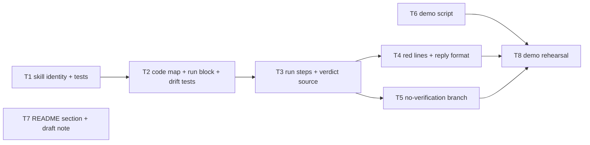

# Epic — check-act-skill

> **Spec:** [spec.md](../spec.md) · **Design:** [sad.md](../sad.md) · **Data model:** none (no schema change) · **API:** none (the existing `act-verifier` CLI is the contract, read only — sad §2) · **ADRs:** [adr/](../adr/)

## Goal

Ship the agent link of the chain «AI prepares → code checks → human decides»: a check-act skill that lets an L1 agent run the unchanged verifier and explain its verdict, findings, what was not checked, what to do and where the numbers come from, leaving the decision with the accepting person (spec §2 goal 1). Make it demonstrable on three scenarios with recorded actual behaviour (goal 2), and guarded against drift from the verifier by the test suite (goal 3).

## Scope

- **In:** `.claude/skills/check-act/SKILL.md` (new), `tests/test_check_act_skill.py` (new), `docs/features/check-act-skill/demo.md` (new), `README.md` section, `CLAUDE.md` test count, superseded note on the owner's draft `SKILL.md`. Layers: `ports` (the skill — the agent-facing surface over the CLI), `tests`, `docs`.
- **Out:** any change to the verifier, the fixture generator or the fixtures; the assistant-agent tool (roadmap step 2); act preparation by the agent; automated proof of agent behaviour; fixes to known verifier message defects (spec §3).

## Task map

Waves: **1** T1 ‖ T6 ‖ T7 · **2** T2 · **3** T3 · **4** T4, T5 (same file — serialized) · **5** T8 (manual, owner).

## Tasks

See [tracker.md](./tracker.md) for status. Machine contract: [tasks.json](../tasks.json).

| # | Task | Layer | Blocked by | DoD (short) |
|---|---|---|---|---|
| T1 | [Skill file + identity drift tests](./T1-skill-identity.md) | ports | — | AC-11 identity tests red→green; suite 304 + n green |
| T2 | [Outcome-code map + run-command block + drift tests](./T2-outcome-map-and-run-command.md) | ports | T1 | AC-10 drift tests green, mismatch names the item; CLAUDE.md = 304 + N |
| T3 | [Run steps: inputs, run, verdict source](./T3-skill-run-steps.md) | ports | T2 | AC-01b/04/08/09 mapped to skill sentences; suite green |
| T4 | [Red lines + five-section reply format](./T4-skill-reply-format.md) | ports | T3 | AC-01/02/02b/03/07 mapped; suite green |
| T5 | [No-verification branch: input errors, crash](./T5-skill-no-verification.md) | ports | T3 | AC-05/05b/06/06b mapped; suite green |
| T6 | [Demo script demo.md](./T6-demo-script.md) | docs | — | three scenarios with prompt, expected, folder, empty actual fields |
| T7 | [README section + draft superseded](./T7-readme-section.md) | docs | — | AC-13 section present; draft marked; OQ 2/3 outcome stated |
| T8 | [Demo rehearsal, actual results](./T8-demo-rehearsal.md) | tests | T4, T5, T6 | 3 actual fields filled; hashes equal; 0 red-line violations target |

AC coverage: AC-01 T4 · AC-01b T3 · AC-02 T4 · AC-02b T4 · AC-03 T4 · AC-04 T3 · AC-05 T5 · AC-05b T5 · AC-06 T5 · AC-06b T5 · AC-07 T4 · AC-08 T3 · AC-09 T3 · AC-10 T2 · AC-11 T1 · AC-12 T6, T8 · AC-13 T7 — 17 of 17.

## Risks / Hard rules

- No change to `src/act_verifier/`, `scripts/generate_fixtures.py` or `tests/fixtures/` (spec §3; CLAUDE.md).
- Suite: 304 + N passed, 0 failed, 0 xfailed; 0 model and 0 network calls; drift tests start no subprocess (spec §6; ADR-0003).
- The L1 agent opens no input file, writes no file, runs no command but `.venv/Scripts/act-verifier` (spec §6.1; ADR-0002).
- Verdict only for exit 0/1/2 plus «Вердикт: <token>.» in that run's stdout; otherwise no report is read (sad §4 choice 4).
- Every number in a reply appears verbatim in the report, evidence block, input-error message or the person's words (AC-03).
- Agent behaviour (T3–T5) has no automated test by design — T8 is its only evidence; rehearse before 2026-11-27 (sad §11 risk 2).
- Open: spec §8 OQ 2 (does the reviewer run the skill?) and OQ 3 (fate of the draft) — defaults applied in T7 unless the owner decides otherwise.
