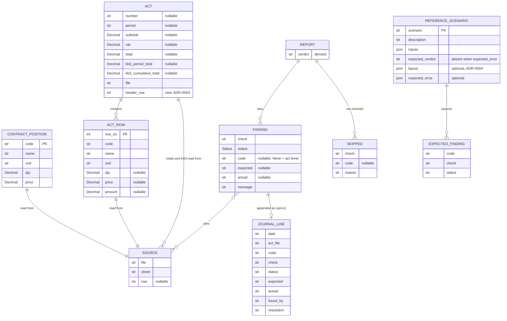

# Data model — cli-verifier

> **No schema change — zero migrations.** The repo has no database (`docs/architecture-map.md`
> §Conventions: «Migrations: none (no database)», `migration_tool: ""`). Every store is a file:
> input workbooks (read-only), the report folder, the opt-in error-journal CSV and the
> generator-owned reference files. This document records the **shapes** the feature reads and
> writes — the domain dataclasses in `src/act_verifier/models.py` and the file layouts — so `api`,
> `tasks` and `implement` share one definition. Types are written in the repo's vocabulary
> (Python type hints); money and volumes are `Decimal` only (CLAUDE.md, sad §8).

## ER diagram

## Entities

### Aggregate map

Aggregate roots are inferred from sad §5 (no database → no FK graph to negotiate):

| Aggregate root | Owns | Lifetime | Store |
|---|---|---|---|
| `ContractPosition` map (`dict[str, ContractPosition]`) | `Source` per position | in-memory, one run | contract workbook, sheet «Договірна ціна» (read-only) |
| `Act` | `ActRow`, `Source` per value, skipped rows | in-memory, one run | act workbook, sheets «КБ-2в» + «КБ-3» (read-only); previous acts likewise |
| `Report` | `Finding`, `Skipped` | persisted per run | `reports/` — Excel sheet «Перевірки» + Markdown |
| `JournalLine` | — | append-only, survives runs | `journal/agent_errors.csv` or `--journal PATH` |
| `ReferenceScenario` | `ExpectedFinding`, optional `layout` / `expected_error` | versioned in git, generator-owned | `tests/fixtures/<scenario>/expected.json` |

`InputError(kind, label, file, sheet, rows)` (ADR-0002) is an exception, not data — it never
reaches a store; outcome code 3 means no report is written (spec AC-06/07/08/13).

### `ContractPosition`

| Field | Type | Constraints | Notes |
|---|---|---|---|
| `code` | `str` | key of the contract map; unique | «Шифр»; exact match for C01 (docs/checks.md) |
| `name` | `str` | | «Найменування» |
| `unit` | `str` | | «Од. виміру»; compared after `strip()` (C02) |
| `qty` | `Decimal \| None` | `None` = empty cell, never 0 | «Кількість»; base of C05 remaining volume; `None` → C05 `unknown` («у договорі порожня кількість») |
| `price` | `Decimal \| None` | `None` = empty cell, never 0 | «Ціна»; C03 tolerance 0,00; `None` → C03 `unknown` («у договорі порожня ціна») |
| `source` | `Source` | required | file / sheet / row actually read (ADR-0003) |

**Aggregate root:** the contract map.
**Access patterns:** `contract[code]` per act row → C01–C05.
**Constraints:** a duplicate code in the contract is an input error (outcome code 3, `InputError("duplicate_code")` naming the code and the competing rows) — neither the first nor the last row is used (decided in implement, recorded after review 2026-11-26, finding 7; own kind since review 2, finding 2 — ADR-0002 amendment). An empty `qty`/`price` cell is read as `None` (missing data, not an input error) — resolves audit drift item D5.

### `Act`

| Field | Type | Constraints | Notes |
|---|---|---|---|
| `number` | `int \| None` | `None` = act number missing or unreadable → missing data, not an input error (AC-07, AC-11) | from the act-number title |
| `period` | `str \| None` | | |
| `rows` | `list[ActRow]` | only rows with a position code (AC-09) | |
| `subtotal` | `Decimal \| None` | | «Разом без ПДВ» value, as printed (AC-12) |
| `vat` | `Decimal \| None` | | «ПДВ» |
| `total` | `Decimal \| None` | | «Всього з ПДВ»; for previous acts the only total read |
| `kb3_period_total` | `Decimal \| None` | | КБ-3 «Всього за звітний період» |
| `kb3_cumulative_total` | `Decimal \| None` | | КБ-3 «З початку виконання робіт» |
| `file` | `str` | required | |
| `sources` | `dict[str, Source]` | **new** (ADR-0003) | provenance of each totals / КБ-3 / title value |
| `header_row` | `int` | **new** (ADR-0003) | header row as found, for the evidence block |
| `skipped_rows` | `list[int]` | **new** (ADR-0003) | empty rows / rows without a code between table and totals (AC-09) |
| `sheet` | `str` | always set by `load_act`; defaults to «КБ-2в» for acts built in memory; **new** (ADR-0003, review 2, finding 3) | КБ-2в sheet title as found by prefix (e.g. «КБ-2в акт 3»); cited in every КБ-2в provenance |

**Aggregate root:** root.
**Access patterns:** previous acts grouped by `number` for the completeness check (K of N−1, AC-11); Σ `qty` by `code` across previous acts → C05 (AC-10).
**Constraints:** empty cell or formula without stored value → `None`, never `0` (sad §8).

### `ActRow`

| Field | Type | Constraints | Notes |
|---|---|---|---|
| `row_no` | `int` | Excel row number as found | ordering key for deterministic findings (sad §8) |
| `code` | `str` | non-empty (rows without code are not positions) | |
| `name` | `str` | | |
| `unit` | `str` | | |
| `qty` | `Decimal \| None` | | `None` → C04/C05 not checked (AC-05) |
| `price` | `Decimal \| None` | | `None` → C03/C04 not checked (AC-04/05) |
| `amount` | `Decimal \| None` | | `None` → C04 not checked, subtotal C07 unknown (AC-05) |
| `source` | `Source` | required | |

**Aggregate root:** `Act`.

### `Source`

| Field | Type | Constraints | Notes |
|---|---|---|---|
| `file` | `str` | required | |
| `sheet` | `str` | required | |
| `row` | `int \| None` | | `None` = sheet-level |

Frozen dataclass (value object). Shared by every aggregate — the evidence block is built only from these (ADR-0003).

### `Report`

| Field | Type | Constraints | Notes |
|---|---|---|---|
| `findings` | `list[Finding]` | includes `pass` findings (AC-01) | sorted by (row order, check ID) |
| `skipped` | `list[Skipped]` | **type change** from `list[str]` (ADR-0003) | the «not checked» list of the evidence block |
| `verdict` | `str` (derived property) | `fail` if any fail; else `needs_review` if any unknown/warning; else `pass` | outcome code 1 / 2 / 0 |

**Aggregate root:** root.
**Persisted as:** Excel sheet «Перевірки» (code · check · status · expected · actual · source) + Markdown file ending with the evidence block (spec §1, AC-03). Determinism: no timestamps in findings or evidence block.

### `Finding`

| Field | Type | Constraints | Notes |
|---|---|---|---|
| `check` | `str` | an ID from `docs/checks.md` | e.g. `C03_price_matches_contract` |
| `status` | `Status` | `pass \| fail \| unknown \| warning` | |
| `code` | `str \| None` | `None` = act-level check | |
| `expected` | `str \| None` | | Decimal rendered as read, no float |
| `actual` | `str \| None` | | |
| `message` | `str` | | Ukrainian |
| `sources` | `list[Source]` | | AC-10: contract + each previous act |

**Aggregate root:** `Report`.

### `Skipped` (new, ADR-0003)

| Field | Type | Constraints | Notes |
|---|---|---|---|
| `check` | `str` | check ID | |
| `code` | `str \| None` | position code; `None` = act level | |
| `reason` | `str` | required | e.g. «порожня ціна», «previous acts supplied: K of N−1» (AC-04, AC-11) |

Every `Finding` with status `unknown` caused by missing data (all except C11, which is itself the presence check) has a `Skipped` with the same check, code and reason (= the finding's message), so the evidence block lists it (AC-03).

**Aggregate root:** `Report`.

### `JournalLine` (CSV row)

| Column | Type | Constraints | Notes |
|---|---|---|---|
| `date` | `str` | | the only clock in the output (sad §8) |
| `act_file` | `str` | | |
| `code` | `str` | empty for act-level | |
| `check` | `str` | | |
| `status` | `str` | `fail \| unknown \| warning` only | pass is never journaled (AC-14) |
| `expected` | `str` | | numbers exactly as read |
| `actual` | `str` | | numbers exactly as read |
| `found_by` | `str` | always the verifier | |
| `resolution` | `str` | always empty on write | |

Header line exactly as `journal/agent_errors.csv:1`. File created with the header if absent; append-only. Non-numeric text starting with `=`, `+`, `-`, `@` gets a leading apostrophe (formula-injection guard, AC-14).

### `ReferenceScenario` (`expected.json`)

| Key | Type | Constraints | Notes |
|---|---|---|---|
| `scenario` | `str` | = fixture directory name | |
| `description` | `str` | | |
| `inputs` | `{contract, previous_acts[], act}` | paths | |
| `expected_verdict` | `str` | absent when `expected_error` present | |
| `expected_findings` | `list[{code, check, status}]` | non-pass only; absent when `expected_error` present | |
| `layout` | object, optional | **new** (ADR-0004) | per input role: `header_row`, `first_data_row`, `subtotal_row`, `vat_row`, `total_row`; absent → README layout |
| `expected_error` | `{kind, label}`, optional | **new** (sad §5) | `kind ∈ {missing_label, ambiguous_label}`; label as written in spec |

**Aggregate root:** root. **Write path:** only `scripts/generate_fixtures.py` (CLAUDE.md) — never edited by hand.

## Indexes

N/A — no database. The in-memory lookups the flows need (sad §6) are listed instead, each tied to its query:

| Lookup | Key | Query it serves |
|---|---|---|
| contract map | `ContractPosition.code` | F1: per act row, find the contract position for C01–C05 |
| previous-acts volume sum | `ActRow.code` over previous acts | F1/F4: remaining volume = contract qty − Σ previous qty (C05, AC-10) |
| previous-acts by number | `Act.number` | F4: completeness K of N−1, duplicates, out-of-range numbers (AC-11) |

## Test fixtures

Not in migrations (there are none). Fixtures are produced only by `scripts/generate_fixtures.py` (deterministic literal Decimals); the feature adds seven scenarios (spec AC-15):

- shifted header — header row not at the README row; writes a `layout` map (AC-09).
- totals not right after the table — empty / no-code rows before «Разом без ПДВ»; writes a `layout` map (AC-09).
- missing label — one layout label absent; `expected_error.kind = missing_label` (AC-07).
- ambiguous label — a label matching two rows; `expected_error.kind = ambiguous_label` (AC-08).
- empty quantity — one position with an empty quantity (AC-05).
- empty amount — one position with an empty amount (AC-05).
- incomplete previous acts — previous acts not exactly 1…N−1 (AC-11).

Directory names are not fixed upstream; `implement` chooses them in the generator. Synthetic data only — no real names, contractors or contacts.
