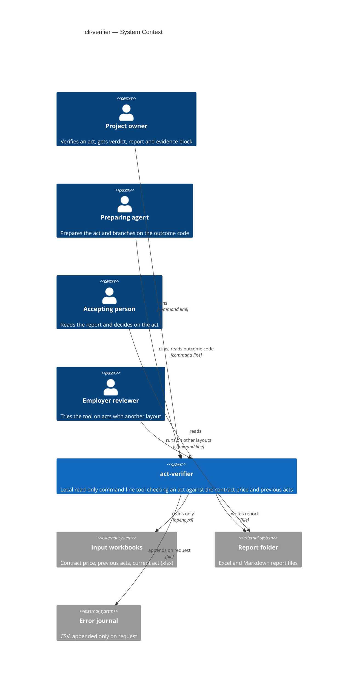
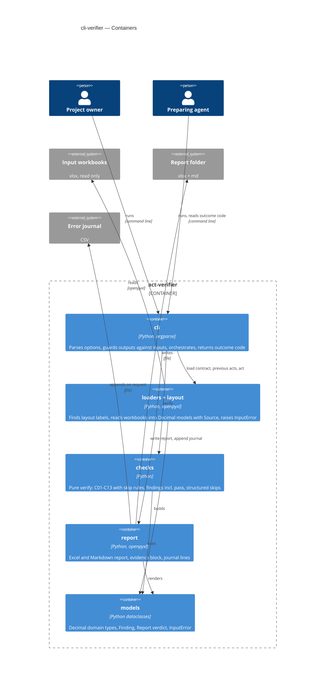
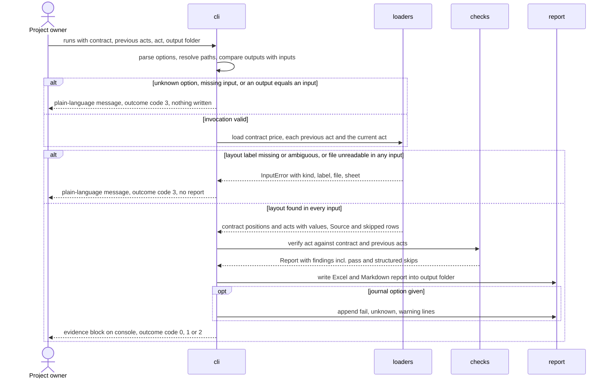

# Software Architecture Document — cli-verifier

<!-- 12 Arc42 sections. Empty section → <!-- N/A: <one-line reason> -->. -->
<!-- C4 Context (L1) lives inline in §3. C4 Container (L2) lives inline in §5. -->
<!-- Numbers in §10 come VERBATIM from spec.md §6 NFR — no inventing, no rounding. -->

## 1. Introduction and goals

**Intent.** Turn the stub core of act-verifier into a working stage-1 command-line verifier: the project owner points it at a contract price, the previous acts and the current act, and gets a verdict (pass / fail / needs_review), a findings report and an evidence block, with outcome codes 0 / 1 / 2 and 3 for an input error (spec §2, §5). The file layout is located by layout labels, not fixed rows, so an act whose labels sit in different rows still verifies, and an unrecognised layout stops with an input error naming the label instead of a silent wrong verdict. The 14 reference scenarios plus 7 new generator scenarios prove it.

**Top-3 quality goals (1-liners; full scenarios in §10):**

1. **No false pass** — missing data or a discrepancy never yields `pass`; missing data is `unknown`.
2. **Layout tolerance with a loud failure** — labels found anywhere in the expected region verify the same way; a missing or ambiguous label is an input error (outcome code 3), never a guess.
3. **Inputs are never modified** — the verifier only reads its inputs and refuses any run whose output would land on an input.

**Stakeholders.**

| Role | Interest | Sign-off owner? |
|---|---|---|
| project owner | Runs the verifier, gets the verdict, report and evidence block; owns stage 1 | Yes |
| accepting person | Reads the report and evidence block to decide on the act | No |
| preparing agent | Branches on the outcome code (fix the act / hand to a person / fix the invocation) | No |
| employer reviewer | Tries the tool on acts with a different layout; judges the project | No |
| Tech Lead | SAD approval | Yes |

<!-- Decision overrides (¶4) — populated by the critic resolution loop, empty otherwise. -->

## 2. Constraints

**Technical.**
- Python ≥ 3.11, src layout, setuptools ≥ 68 (`pyproject.toml`).
- `openpyxl >= 3.1` for reading and writing workbooks; no new runtime dependency. `pandas` is declared but stays unused (§11 debt).
- Standard-library `argparse` for the command line (existing `src/act_verifier/cli.py`), `decimal.Decimal` for all money and quantities.
- Existing module split stays: `models` (domain) ← `loaders`, `checks`, `report` ← `cli` (architecture-map «Module inventory»). Plain function calls with dataclass values, no DI.
- Platform: Windows + Git Bash; tests run with `.venv/Scripts/python -m pytest -q` (spec §6).

**Organisational.**
- Size S, single developer (project owner); no deadline date — before the employer's test assignment (spec §1).
- Stage-2 assistant-tool interface reuses this core later (roadmap step 2) — public functions `load_contract`, `load_act`, `verify` keep their signatures.

**Conventions.**
- `CLAUDE.md` rules are hard: Decimal only; numbers only from files; missing data → `unknown`, never `pass`; fixtures change only via `scripts/generate_fixtures.py` with a stated reason; the verifier never writes to its inputs; every report ends with the evidence block.
- Identifiers in English; docstrings, comments and user-facing text (report, messages) in Ukrainian (architecture-map «Language»).
- Check IDs exactly as in `docs/checks.md` (`C01_position_in_contract` … `C13_kb3_cumulative`).
- Excel floats are converted with `Decimal(str(value))`; money rounded to kopecks with `ROUND_HALF_UP` (README «Формат вхідних файлів»).

**Regulatory / external.**
- N/A — synthetic data only; real acts are confidential and stay outside the repository (spec §6.1); no personal data.

## 3. Context and scope

The verifier is a local, read-only command-line tool. A project owner or a preparing agent runs it on three kinds of workbook — contract price, previous acts, current act — and it writes a report into an output folder and, only on request, appends lines to the error journal. An accepting person reads the report; nothing outside the machine is contacted.

<!-- brownfield: architecture-map.md (reflects 39ee7a6; src/tests/scripts unchanged up to aca4427) — models implemented; loaders/checks/report/cli are NotImplementedError stubs; generator + 14 fixtures implemented. -->

**External systems (in / out):**

| Actor or system | Type | Interaction |
|---|---|---|
| project owner | Person | Runs the command, reads console output and report files |
| preparing agent | Person (or AI agent) | Runs the command, branches on outcome code 0/1/2/3 |
| accepting person | Person | Reads the Excel/Markdown report and the evidence block |
| employer reviewer | Person | Runs the command on acts with another layout |
| Input workbooks | Files (external to the tool, trust boundary) | Read only: contract price «Договірна ціна», acts «КБ-2в» + «КБ-3» |
| Report folder | Files | Written: Excel + Markdown report per run (default `reports/`, gitignored) |
| Error journal | File (`journal/agent_errors.csv`, tracked) | Appended only with `--journal` |

Trust boundary: everything read from a workbook is untrusted — labels may be missing, duplicated or shifted, values may be empty or formulas without a stored value; text fields copied to the journal are escaped (spec §6.1).

**C4 Context (L1):**



## 4. Solution strategy

**Target surface.** `cli` only — a console application with flags and outcome codes (spec US-01, US-03). The stage-2 assistant-tool server (roadmap step 2) is a later, separate surface that will call the same core functions; it is not built here.

**Top strategic choices (the seeds for ADRs):**

1. **Locate the layout by normalized, unique labels** — every structural place (sheet, header columns, totals rows, КБ-3 rows, act-number title) is found by a label after normalization (trim, collapse whitespace incl. non-breaking, ignore case) and prefix match, inside a defined search region; zero matches or more than one match is an input error — except the act-number title, whose absence or non-numeric value is missing data (`unknown` of C05/C13, spec §1, AC-07). Fixed README row numbers are only test-side documentation. Serves quality goal 2 → [ADR-0001](adr/0001-locate-layout-by-normalized-unique-labels.md).
2. **Signal input errors with one typed exception** — loaders raise `InputError(kind, label, file, sheet, rows)` at the first unreadable structure; the command boundary maps it to outcome code 3. A half-read act can never reach the checks. Serves goals 1 and 2 → [ADR-0002](adr/0002-signal-input-errors-with-typed-exception.md).
3. **Carry provenance with every value, build the evidence block from it** — each value the loaders read carries a `Source` (file, sheet, row); checks emit a `Finding` for pass too and a structured skip record for every check not performed. The evidence block is rendered only from this data, never from assumed README rows. Serves goal 1 and spec AC-03/AC-09 → [ADR-0003](adr/0003-carry-source-on-every-value-and-structured-skips.md).
4. **Prove the layout headroom with generator-recorded layout maps** — the fixture generator records where it placed header, data and totals rows in an optional `layout` field of `expected.json`; the integrity tests read fixtures by that map (still independent of `src/`), and the evidence-block rows are compared against it. Serves goal 2 → [ADR-0004](adr/0004-record-generator-layout-map-in-reference-file.md).

Pure core, thin shell: `loaders` and `checks` are pure functions (no writes); every write (report, journal) and the overwrite guard live in `cli`/`report`, after the guard has run (goal 3).

## 5. Building block view

Layered, as already laid out in the repo: a domain module (`models`) with no internal imports; input adapter (`loaders` + a new `layout` helper), domain logic (`checks`), output adapter (`report`), entry (`cli`). Dependencies point inward to `models`. No new package.

**Internal decomposition:**

```
src/act_verifier/
├── models.py     domain: Status, Source, ContractPosition, ActRow, Act, Finding, Report
│                 + InputError (kind, label, file, sheet, rows)      — ADR-0002
│                 + Skipped (check, code, reason)                     — ADR-0003
│                 + Act.sources / header_row / skipped_rows           — ADR-0003
├── layout.py     NEW: normalize(text), find_sheet, find_header_row, find_label_row
│                 (prefix match, region, uniqueness → InputError)     — ADR-0001
├── loaders.py    load_contract(path) -> dict[str, ContractPosition]
│                 load_act(path) -> Act   (openpyxl, data_only=True, read-only)
├── checks.py     verify(act, contract, previous_acts) -> Report
│                 row checks C01–C06, C11; act checks C07–C10, C12, C13;
│                 previous-acts completeness (N, K) computed once
├── report.py     write_excel, render_markdown, render_evidence, append_error_log
└── cli.py        argparse (error → InputError(invocation)), overwrite guard,
                  orchestration, outcome code 0/1/2/3
scripts/generate_fixtures.py   + 7 scenarios, + optional `layout` / `expected_error`
tests/test_verifier.py         scenario test incl. expected_error; xfail removed
tests/test_cli.py              NEW: outcome codes per scenario, overwrite refusal, journal
tests/test_fixtures_integrity.py   schema accepts layout/expected_error; reads by layout map
```

**C4 Container (L2):**



**Reference-file extensions (generator-owned, ADR-0004 / spec AC-15):**
- `layout` (optional): per input role, the rows the generator used — e.g. `{"act": {"header_row": 10, "first_data_row": 11, "subtotal_row": 24, "vat_row": 25, "total_row": 26}}`. Absent → README layout.
- `expected_error` (optional): `{"kind": "missing_label" | "ambiguous_label", "label": "<label as written in spec>"}`. When present, `expected_verdict` and `expected_findings` are absent; the scenario test asserts `InputError` with that kind and label, the command test asserts outcome code 3 and no report files.

## 6. Runtime view

**Critical flow 1: verify an act from the command line (happy path + input error)**



**Critical flow 2:** previous-acts completeness and the empty-value branches are within `checks` (one participant) — detailed per AC by the `sequences` stage.

## 7. Deployment view

<!-- N/A: local developer install (`pip install -e ".[dev]"`), console script `act-verifier`; no server, no replicas, no monitoring. Run-time target is in §10 QG-4. -->

## 8. Crosscutting concepts

| Concept | Convention | Where defined |
|---|---|---|
| Numbers | `Decimal(str(cell))` on read; money quantized to 0.01 `ROUND_HALF_UP`; tolerance `TOLERANCE = 0.01`; no float arithmetic | CLAUDE.md, `checks.py` constants |
| Empty values | empty cell or formula without a stored value (`data_only=True` → `None`) is `None`, never 0; `None` → `unknown` or skip, never `pass` | spec AC-04/AC-05, ADR-0003 |
| Label matching | `layout.normalize`: trim, collapse all whitespace incl. NBSP, casefold; prefix match; exactly one match in the region | spec §1, ADR-0001 |
| Error handling | `InputError` from loaders, argparse and the overwrite guard in `cli`; caught only in `cli.main` → stderr message (Ukrainian) + outcome code 3; any other exception is a bug, not code 3 | ADR-0002 |
| Outcome codes | 0 pass, 1 fail, 2 needs_review, 3 input/invocation error; `argparse` exit 2 suppressed by a parser subclass | spec §1, AC-06 |
| Provenance | every value carries `Source(file, sheet, row)`; evidence block built only from Sources and `Skipped` records | ADR-0003 |
| Write safety | overwrite guard before any write: report paths and journal path compared with every input as fully resolved, case-folded paths; inputs opened read-only | spec AC-13 |
| Journal | opt-in `--journal [PATH]`; default `journal/agent_errors.csv` relative to cwd; created with header if absent; non-numeric text starting with `= + - @` gets a leading apostrophe; `found_by` = verifier, `resolution` empty | spec AC-14 |
| Determinism | findings sorted by (row order, check ID); no timestamps in findings or evidence block (journal `date` column is the only clock) | spec §6 |
| Internationalisation | single language: Ukrainian user-facing text; English identifiers | architecture-map |
| Logging / observability | N/A — console output only; the report and evidence block are the audit trail | — |

## 9. Architecture decisions

| # | Title | Status | Section |
|---|---|---|---|
| 0001 | Locate layout by normalized unique labels | Accepted | §4 |
| 0002 | Signal input errors with a typed exception | Accepted | §4 |
| 0003 | Carry a Source on every value and record skips as structured entries | Accepted | §4 |
| 0004 | Record the generator's layout map in the reference file | Accepted | §4 |

ADR files live under `docs/features/cli-verifier/adr/NNNN-<title>.md`.

## 10. Quality requirements

**QG-1. No false pass**
- **When:** any reference scenario with missing data or a discrepancy is verified (AC-04, AC-05, AC-11 and the fail scenarios).
- **Then:** 0 runs reporting pass while data is missing or a discrepancy exists.
- **How verify:** reference scenarios + AC-04, AC-05, AC-11 (`tests/test_verifier.py`, `tests/test_cli.py`).

**QG-2. Layout tolerance with a loud failure**
- **When:** shifted-header, totals-not-after-table, missing-label and ambiguous-label scenarios are verified.
- **Then:** shifted layouts give the same verdict and findings as the README layout and the evidence block cites the rows in the generator's `layout` map; missing/ambiguous labels stop with outcome code 3 naming the label.
- **How verify:** generator scenarios + `expected_error` / `layout` assertions (ADR-0004).

**QG-3. Inputs are never modified**
- **When:** any run, including one whose report or journal location coincides with an input.
- **Then:** 0 bytes changed in any input file; the coinciding run is refused with outcome code 3 before any write.
- **How verify:** test comparing file hashes before and after a run; command-level test pointing the report location at an input.

**QG-4. Run time and determinism**
- **When:** the «ok_many» scenario (11 positions, 2 previous acts) is run, twice.
- **Then:** ≤ 5 s wall-clock on the developer laptop; 0 differences in findings and evidence block across 2 runs on the same inputs.
- **How verify:** timing of the «ok_many» scenario in the test suite; test comparing the outputs of two runs.

**QG-5. Money accuracy**
- **When:** any arithmetic check runs.
- **Then:** exact decimals, tolerance ±0.01 UAH as in docs/checks.md; 0 floating-point operations in arithmetic.
- **How verify:** code review + all reference scenarios.

## 11. Risks and technical debt

| Risk / debt | Severity | Mitigation | Owner |
|---|---|---|---|
| Real employer acts use a layout the prefix labels do not match | High | Every miss is an input error naming the label (ADR-0001); spec §8 OQ tracks the first real act | AlexanderSW |
| Scenario tests stay `xfail(strict=False)` and silently become «xpassed», not «passed» | Medium | Remove the xfail marker in the same change that makes them green (CLAUDE.md «Готово» = not xfail) | AlexanderSW |
| Integrity helper hard-codes rows 7/9 and breaks on shifted fixtures | Medium | Read by the generator's `layout` map, README rows as fallback (ADR-0004) | AlexanderSW |
| `argparse` exits with 2 (= needs_review) on a bad option | Medium | Parser subclass raises `InputError(kind="invocation")` → 3 (§8); command test for an unknown option | AlexanderSW |
| Tests append to the tracked journal and dirty the tree | Low | Journal tests always pass a `tmp_path` location; default journal never touched by tests | AlexanderSW |
| Prefix «ПДВ» or «Всього» matches an unrelated text row | Low | Search region limited to rows below the header (КБ-2в); ambiguity is an input error, never «first match» | AlexanderSW |
| Report write fails (e.g. the Excel file is open and locked on Windows) and may leave a partial file | Low | Not covered by the spec: treated as a bug, not an input error — the `OSError` propagates and the process exits with Python's default code 1, which a preparing agent can confuse with fail; writes happen only after verify and the overwrite guard | AlexanderSW |

**Accepted debt (acceptable in v1, plan to fix later):**
- `pandas` stays declared but unused (`pyproject.toml`).
- Rules «empty printed total → unknown» and «empty quantity in a previous act → C05 unknown» have no generator scenario in stage 1 (spec §8).
- `InputError` stops at the first problem; listing all missing labels at once is not provided (ADR-0002).

## 12. Glossary

Domain terms (act, contract price, previous acts, layout label, input error, finding, status, verdict, evidence block, error journal, roles) are canonical in [CONTEXT.md](../../../CONTEXT.md). Technical terms introduced by this SAD:

| Term | Meaning |
|---|---|
| normalization | trim, collapse every whitespace run (incl. non-breaking) to one space, casefold — applied to both the label and the cell text before a prefix match |
| search region | the rows and columns in which a label is looked up (e.g. КБ-2в totals only below the header row) |
| layout map | the generator-recorded rows of header, data and totals for a fixture, stored in `expected.json` `layout` |
| `InputError` | the single exception type for an input error, carrying kind, label, file, sheet and competing rows |
| skip record (`Skipped`) | a check not performed for a position or the act, with the reason; rendered under «не перевірено» |
| Source | provenance of one value: file, sheet, row |
