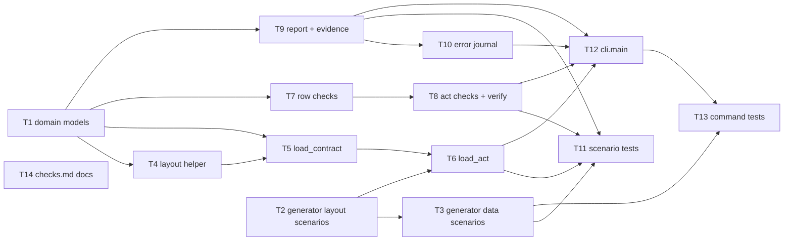

# Epic — cli-verifier

> **Spec:** [spec.md](../spec.md) · **Design:** [sad.md](../sad.md) · **Data model:** [data-model.md](../data-model.md) · **API:** [contracts/cli.md](../contracts/cli.md) · **ADRs:** [adr/](../adr/)

## Goal

Turn the stub core into a working stage-1 command-line verifier. The project owner runs it on a contract price, the previous acts and the current act. It returns a verdict, a findings report and an evidence block, with outcome codes 0/1/2/3. Layout headroom is proven by generator scenarios: shifted rows verify the same way, and a missing or ambiguous label stops with an input error. No run reports `pass` on missing data, and no run touches its inputs (spec §2).

## Scope

- **In:** `models` (domain), the new `layout` helper and `loaders` (infra), `checks` (app), `report` (infra, output adapter), `cli` (ports), the fixture generator with 7 new scenarios, the scenario, command and integrity tests, and `docs/checks.md`.
- **Out:** real employer acts, the stage-2 assistant tool, numbers written as text, non-standard hyphens, zero quantity, a dedicated C13 `fail` fixture (spec §3).

## Decisions

- **Owner decision (tasks stage, 2026-11-26, closes cli.md OQ-A1):** report files are `<act-stem>_report.xlsx` and `<act-stem>_report.md` in `--out` (act-stem = current act file name without extension); a rerun overwrites them; a missing `--out` folder is created (parents too) — after the overwrite guard. Still to record upstream: spec §1 + `/sdd:api cli-verifier --reconcile` for `contracts/cli.md` §6.1.
- **Breakdown-time readings (confirm in review, not upstream decisions):**
  - A duplicate «Акт №» title means the act number is not readable (missing data). It never means a guessed number (T4).
  - A previous act may lack «Разом без ПДВ». Its table then ends above «Всього з ПДВ» (T6).
  - `load_act` gets a keyword-only `previous: bool = False`, which keeps the signature (T6).
- **Left open upstream:** cli.md OQ-A2 (`--help` exits 0). Data-model TBDs: a duplicate code in the contract, and an empty contract qty or price. T5 lists them in its review notes.

## Task map

**Waves:** 1 — T1, T2, T14 · 2 — T3, T4, T7, T9 · 3 — T5, T8, T10 · 4 — T6 · 5 — T11, T12 · 6 — T13.
**Serialized lanes (shared `files_hint`):** T2→T3 (generator, fixtures, `CLAUDE.md`) · T5→T6 (`loaders.py`) · T7→T8 (`checks.py`) · T9→T10 (`report.py`).

## Tasks

See [tracker.md](./tracker.md) for status. Machine contract: [tasks.json](../tasks.json).

| # | Task | Layer | Blocked by | DoD (short) |
|---|---|---|---|---|
| T1 | [Extend models with InputError, Skipped and per-value provenance](./t01-domain-models.md) | domain | — | `tests/test_models.py` green; suite still at pre-implementation state |
| T2 | [Add layout map, expected_error and four layout scenarios to the generator](./t02-generator-layout-scenarios.md) | tests | — | integrity suite green over new fixtures; old fixtures byte-identical; CLAUDE.md state updated |
| T3 | [Add empty-quantity, empty-amount, incomplete-previous-acts scenarios](./t03-generator-data-scenarios.md) | tests | T2 | 21 fixtures; integrity green; 21 xfailed recorded in CLAUDE.md |
| T4 | [Implement the layout helper](./t04-layout-helper.md) | infra | T1 | `tests/test_layout.py` green; never returns a first match |
| T5 | [Implement load_contract and the shared cell readers](./t05-load-contract.md) | infra | T1, T4 | contract loads 14 Decimal positions; missing/unreadable → `InputError` |
| T6 | [Implement load_act](./t06-load-act.md) | infra | T2, T5 | rows/sources equal the `layout` map on layout fixtures |
| T7 | [Implement row checks C01–C06, C11 + completeness](./t07-row-checks.md) | app | T1 | each skip rule and AC-11 reason asserted in `tests/test_checks.py` |
| T8 | [Implement act checks C07–C10, C12, C13 and verify()](./t08-act-checks-verify.md) | app | T7 | printed-value checks + determinism asserted |
| T9 | [Implement the Excel/Markdown report and the evidence block](./t09-report-evidence.md) | infra | T1 | evidence block last, rows as found, deterministic |
| T10 | [Implement append_error_log](./t10-error-journal.md) | infra | T9 | header creation, append, escaping asserted in `tmp_path` |
| T11 | [Turn the scenario tests green](./t11-scenario-tests.md) | tests | T3, T6, T8, T9 | `test_verifier.py` 21 passed, 0 xfailed |
| T12 | [Implement cli.main](./t12-cli-main.md) | ports | T6, T8, T9, T10 | codes 0/1/2/3; code 3 writes nothing |
| T13 | [Add command-level tests](./t13-cli-tests.md) | tests | T3, T12 | full suite green; all 4 codes exercised; tree clean |
| T14 | [Update docs/checks.md](./t14-checks-catalog-docs.md) | docs | — | every spec §8 OQ 2 rule present, nothing beyond the spec |

## Risks / Hard rules

- `CLAUDE.md`: money and volumes are `Decimal` only. Numbers come only from files. Missing data → `unknown`, never `pass`. Fixtures change only through `scripts/generate_fixtures.py`, with a reason. The verifier never writes to its inputs. Every report ends with the evidence block.
- `sad.md §2`: `load_contract`, `load_act`, `verify` keep their signatures (stage-2 reuse).
- `sad.md §11`: remove the scenario `xfail` in the same change that makes the scenarios green (T11). Journal tests use `tmp_path` only (T10, T13). The integrity helper reads rows by the `layout` map (T2).
- `spec.md §6`: ≤ 5 s for `ok_many`. 0 differences across 2 runs. 0 bytes changed in inputs. 0 false passes (T13 measures these).
