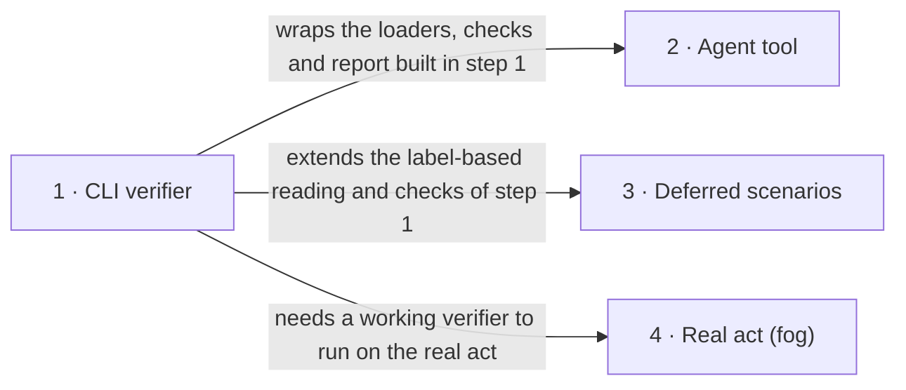

# Roadmap — act-verifier

> **A decomposition, not a promise.** The overall idea broken into incremental steps: what each
> step is, where it comes from, how big it is — or that nobody has looked at it yet — and in which
> order, and parallel lanes, we walk them. **No dates** (except shipped history), **no scores** —
> order is the prioritization. The *solution* for any step lives in its `docs/features/<slug>/`
> spec, not here.

## Destination

The verifier checks any act in a known layout against the contract price and previous acts — from the command line and as a tool an assistant agent can call — and on an unfamiliar layout it stops with a clear input error instead of a silent wrong verdict.

## Steps

| # | Step | Source | Size | Status |
|---|---|---|:---:|---|
| 1 | Stage 1 command-line verifier: the project owner verifies an act and gets a verdict, a findings report and an evidence block → [`docs/features/cli-verifier/`](features/cli-verifier/spec.md) | `docs/features/cli-verifier/idea-brief.md` §7 Recommendation | S | building |
| 2 | Assistant-agent tool: an agent calls «verify act» and «list checks» and gets the verdict, findings and evidence block | `README.md` § План реалізації (step 5); `src/act_verifier/mcp_server.py` docstring | S | idea |
| 3 | Deferred layout and data scenarios: numbers written as text, position codes with other hyphens, zero quantity, a cumulative КБ-3 mismatch scenario | `docs/checks.md` § Наступні сценарії; `docs/features/cli-verifier/idea-brief.md` §5 Out of scope | S | idea |
| 4 | Verify the first real employer act → see [Not yet specified](#not-yet-specified) | `docs/features/cli-verifier/idea-brief.md` §8 Open questions | fog | idea |

## Not yet specified

| Area | What we'd have to learn | Blocks | How it gets sharpened |
|---|---|:---:|---|
| Real employer acts | Their actual layout: sheet names, header and totals labels, number formats, how previous acts are supplied — none of it is known until the test assignment arrives | 4 | Run the stage-1 verifier unchanged on the first real act and compare it with README «Формат вхідних файлів»; every input error names the label that differed |

## Out of scope

- Changing how an act is accepted or rejected — the verifier reports, the accepting person decides (`README.md` intro).
- Writing to or correcting input files — the verifier is read-only by rule (`CLAUDE.md`).

## Open decisions

| # | Question | Type | Owner | Blocks |
|---|---|:---:|:---:|:---:|
| D1 | What layout do the employer's real acts use (sheets, labels, number formats)? | research | human | 4 |
| D2 | Should the deferred scenarios wait for the first real act, so that only deviations it actually shows get built? | grilling | human | 3 |

## Decisions so far

- Stage 1 direction: label-based reading, C01–C13, Excel report with evidence block, outcome codes 0/1/2/3, opt-in journal → [`docs/features/cli-verifier/idea-brief.md` §7](features/cli-verifier/idea-brief.md), [`docs/features/cli-verifier/spec.md` §1](features/cli-verifier/spec.md)
- Stage 1 deferrals (text numbers, other hyphens, zero quantity, C13 fail fixture) → [`docs/features/cli-verifier/idea-brief.md` §5](features/cli-verifier/idea-brief.md)
- Current architecture and constraints → [`docs/architecture-map.md`](architecture-map.md)

## Dependency graph

## Execution path

| Wave | Steps | Zone per step (why parallel-safe) | Unlocks |
|:---:|---|---|---|
| 1 | 1 | 1: `src/act_verifier/` (loaders, checks, report, cli) + `scripts/generate_fixtures.py` + `tests/` | 2, 3, 4 |
| 2 | 2 ∥ 3 | 2: `src/act_verifier/mcp_server.py` · 3: `src/act_verifier/loaders.py`, `src/act_verifier/checks.py`, `scripts/generate_fixtures.py` (disjoint files) | — |

## Shipped

| Step | Shipped | Link |
|---|---|---|
| (none yet) | — | — |
